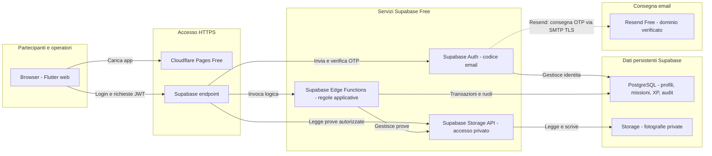

# Sentinelle — architettura target con prodotti

Decisione documentata il 16 ottobre 2026: Supabase per il backend e Supabase
Auth, Resend Free per la consegna dei codici email. Cloudflare Pages Free è
la proposta per il frontend. Questo diagramma descrive il target da implementare,
non un ambiente già distribuito. [Runbook e fonti](sentinelle_deploy_zero_budget_runbook.md).

## Diagramma prodotti

Le frecce rappresentano richieste o consegne; le risposte HTTPS sono implicite.
Il nodo PostgreSQL aggrega il database del progetto, compreso lo schema gestito
da Auth: non implica che Auth scriva direttamente le tabelle di dominio.
Il nodo Storage API rappresenta il servizio Supabase Storage, mentre il nodo
fotografie rappresenta gli oggetti durevoli del bucket privato.

## Flussi e confini di fiducia

1. Cloudflare Pages serve il build Flutter al browser, senza eseguire le regole del gioco.
2. Il browser chiede il codice a Supabase Auth; Auth lo genera e lo invia a
   Resend via SMTP TLS. Resend consegna l’email al partecipante. L’utente
   digita il codice nell’app; Auth lo verifica ed emette la sessione.
3. Flutter usa il token di accesso per invocare Edge Functions. Ogni funzione
   verifica identità, ruolo, Comune, proprietà e stato prima della mutazione.
4. Le invarianti di prenotazioni, XP ed esiti sono applicate con transazioni
   PostgreSQL; idempotenza e revisioni devono sopravvivere ai retry.
5. La lettura diretta delle foto tramite Storage API è ammessa solo con policy
   verificate o URL firmati brevi. Upload e validazione delle prove sono governati
   dal percorso applicativo; il dettaglio del trasporto recuperabile resta da fissare.

Solo URL progetto e chiave pubblicabile possono essere inclusi nel client.
La chiave Resend resta nelle impostazioni SMTP di Supabase; chiavi amministrative
e credenziali database restano server-side. Le operazioni privilegiate devono
controllare le autorizzazioni anche quando la chiave server aggira RLS.

## Elementi non ancora risolti dal diagramma

- Porting del runtime Node verso Edge Functions e compatibilità delle dipendenze.
- Associazione account esistenti/ospiti a `auth.users`, revoca sessioni e MFA operatori.
- Persistenza del diario cancellazioni indipendente dal backup ripristinato.
- Backup coordinato Auth/PostgreSQL/Storage, chiavi e restore: prodotto e procedura da definire.
- Scheduler per scadenze, cleanup e pubblicazione: da scegliere, nessun timer in memoria garantito.
- Dominio mittente e DNS; creazione account Resend e verifica effettiva del percorso senza carta.
- Latenza reale: nessuna garanzia che il target risponda entro gli obiettivi prima della prova.

Render e Firebase non fanno parte di questa architettura. Nessuna migrazione
a Firestore o riscrittura completa delle regole è stata decisa.

## Formati

Il sorgente Mermaid è questo documento e il file
[sentinelle_cloud_architecture.mmd](sentinelle_cloud_architecture.mmd).
La generazione FigJam è in attesa della selezione del team/organizzazione nel
widget Figma; nessun file FigJam completato o URL finale è attestato.
